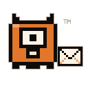

  

# Zurb Mail

**Email for Linux. Still brewing.**

Zurb Mail is a [ZurbZero](https://zurbzero.com) project: a desktop email client being built in Rust,
with GTK4 and libadwaita.

We're working towards a calm home for personal and business mail, with several accounts,
an optional unified inbox and separate profiles when you want to keep things apart.
The interface will follow your desktop's appearance.

Privacy is part of the design: direct connections to your mail providers, local encrypted
storage and no telemetry or advertising.

## Development

Zurb Mail is in active development, initially targeting Linux Mint and LMDE.
Pop!_OS and COSMIC are also in the plan.

This repository is a teaser. Application source code and downloads aren't available here yet.
There's no release date to announce.

## Artwork and licensing

All logos and artwork, including the Zurb mascot and Zurb Mail logo, are trademarks of
ZurbZero. All rights reserved.

The application code licence is still to be decided.
